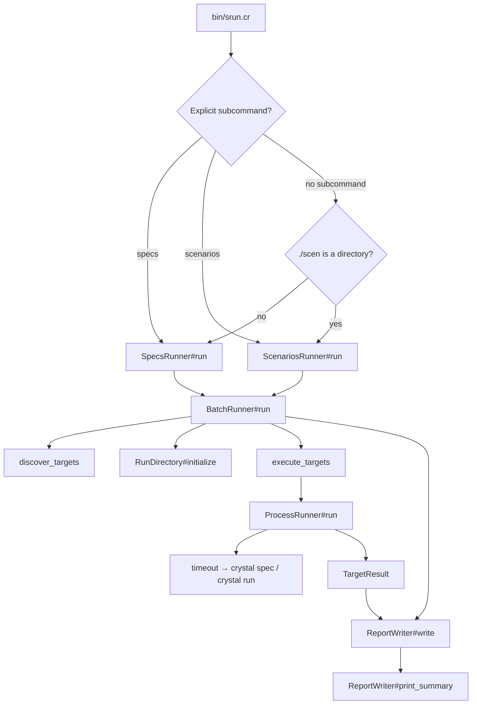

# Execution flow and method dependencies

## Dispatch

## Command behavior

| Entry point | Discovers | Starts per target |
|---|---|---|
| `srun` without `./scen/` | `spec/**/*_spec.cr` | `crystal spec PATH` |
| `srun` with `./scen/` | `scen/**/*.scen.cr` | `crystal run PATH` |
| `srun specs` | `spec/**/*_spec.cr` | `crystal spec PATH` |
| `srun scenarios` | `scen/**/*.scen.cr` | `crystal run PATH` |

Each target is passed to a separate `timeout` process. Consequently, every
spec file and every scenario has its own process boundary and timeout. The
`specs` command never switches to a suite-wide `crystal spec` invocation.

## Method ownership and dependencies

| Type / method | Responsibility | Direct dependencies |
|---|---|---|
| CLI dispatch in `src.source/bin/srun.cr` | Select explicit or automatic mode; validate shared options | `Dir.exists?`, `OptionParser`, `SpecsRunner`, `ScenariosRunner` |
| `SpecsRunner#run` | Configure the spec target batch | `BatchRunner` |
| `ScenariosRunner#run` | Configure the scenario target batch | `BatchRunner` |
| `BatchRunner#run` | Own one run lifecycle and its exit status | `discover_targets`, `RunDirectory`, `update_report`, `report_empty_targets`, `execute_targets`, `successful?`, `ReportWriter` |
| `BatchRunner#discover_targets` | Return sorted paths matching the configured glob | `Dir.glob` |
| `BatchRunner#execute_targets` | Run each discovered path sequentially and record its result | `command_arguments`, `ProcessRunner#run`, `update_report` |
| `ProcessRunner#run` | Execute one Crystal command; classify and move its log | `run_command`, `classify_outcome`, `move_log`, `RunDirectory`, `TargetResult` |
| `ProcessRunner#run_command` | Run GNU `timeout` and capture combined output | `Process.run`, `File.open` |
| `ReportWriter#write` | Rewrite the complete text report after every target | `report_lines`, `result_lines`, `File.write` |
| `ReportWriter#print_summary` | Print final totals and report locations | `RunDirectory`, `TargetResult` |
| `RunDirectory#initialize` | Allocate a unique run directory and its subdirectories | `create_root_directory`, `FileUtils.mkdir_p` |

The dependency direction is intentionally one-way: CLI → mode runner → batch
runner → process/report helpers. `ProcessRunner` does not know whether it is
running a spec or a scenario; it receives the Crystal subcommand and target
path from `BatchRunner`. `ReportWriter` only formats collected results and
does not launch processes.

## Scenario contract

A `*.scen.cr` file is a self-contained acceptance-test executable. It can
initialize its own environment (for example, a Tmux server and a PTY), run
named steps, perform assertions and clean up resources in an `ensure` block.
The scenario passes by exiting with status 0. A raised exception or explicit
non-zero exit status marks that scenario as failed. A scenario timeout also
terminates its child process group.

Scenarios are run sequentially, in sorted path order. They do not share a
Crystal process; persistent external resources must be namespaced per scenario
and cleaned up by the scenario itself.
